# Zip BOF and BOF-PE

`zip` and `unzip` commands for Cobalt Strike. Each command is available as a
native BOF or a BOF-PE, and both formats support x86 and x64 Beacons.

<picture>
  <source media="(prefers-color-scheme: light)" srcset="docs/demo/demo-light.svg">
  
</picture>

## Install

Download a bundle from [Releases](https://github.com/rubyattack3r/Zip-BOF/releases):

- `Zip-BOF-<version>.zip`: the native BOFs.
- `Zip-BOF-PE-<version>.zip`: the BOF-PEs.
- `Zip-BOF-PE-<version>-standalone-{x86,x64}.zip`: standalone `zip.exe` and
  `unzip.exe` for use outside Beacon; see [Standalone executables](#standalone-executables).

Each bundle has a `.sha256` checksum and a build provenance attestation,
which you can check with `gh attestation verify <bundle>.zip -R rubyattack3r/Zip-BOF`.

## Usage

In Cobalt Strike's Script Manager, load `zip.cna` and `unzip.cna` from one
bundle. Do not load both formats at once; they register the same command
names. Each script selects the artifact that matches the Beacon's
architecture.

```text
zip <source> <destination.zip> [level 0-9] [--disk]
unzip <archive.zip> <new-directory>
```

Examples:

```text
zip "C:\Program Files\Example" example.zip 6
zip "C:\Program Files\Example" C:\Windows\Temp\example.zip 6 --disk
unzip C:\Windows\Temp\example.zip C:\Windows\Temp\extracted-example
```

- By default, `zip` builds the archive in memory and downloads it through
  Beacon; `destination.zip` is the download name. With `--disk`,
  `destination.zip` is a path on the target instead.
- The compression level defaults to `6`.
- The `unzip` destination must not already exist.
- Quote paths that contain spaces.

## Behavior and limits

### `zip`

- Download mode (the default) accepts at most 64 MiB of input and 100,000
  entries. Use `--disk` for larger sources; it is not subject to these limits.
- `--disk` writes to a temporary file beside the destination and replaces the
  destination only after the archive is built successfully.
- ZIP64 is used when an archive needs it, such as when it has more than
  65,535 entries.
- Reparse points (symbolic links and junctions) are skipped. When the output
  is written inside the source directory, the archive excludes itself.

### `unzip`

- Archives are rejected if they contain path traversal, absolute or otherwise
  unsafe Windows paths, links, encrypted entries, or unsupported compression
  methods.
- Archives may contain at most 100,000 entries and 8 GiB of uncompressed data.
- If extraction fails, a partially extracted destination directory may
  remain. Delete it before retrying.

Both commands run synchronously, so Beacon is blocked until they finish.

## Paths and filenames

- Relative paths, fully qualified drive paths (`C:\...`), and UNC paths
  (`\\server\share\...`) are supported.
- Windows paths are handled as UTF-16 and ZIP entry names are stored as UTF-8,
  so non-ASCII filenames are preserved.
- Ambiguous paths, such as drive-relative (`C:file`) and current-drive-root
  (`\file`) paths, are rejected, as are Win32 device namespace paths
  (`\\?\` and `\\.\`).
- UNC access uses the Beacon's current token and network permissions.

## Standalone executables

The standalone `zip.exe` and `unzip.exe` run outside Beacon and always write
to disk. Keep `beacon.dll` in the same directory as the executables:

```text
zip.exe <source> <destination.zip> [level 0-9]
unzip.exe <archive.zip> <new-directory>
```

The BOF-PEs and standalone executables do not link a C runtime. They import
only `KERNEL32.dll`, `msvcrt.dll`, and `beacon.dll`, so they do not need the
Universal C Runtime.

Test the commands in a live Beacon before operational use.

## Build from source

```sh
nix develop -c make verify
nix develop -c make release VERSION=v0.1.0
```

The development shell provides Zig, which compiles every target, with the
LLVM tools, linters, and sanitizer runtimes the checks use. `make verify`
lints the C sources, scripts, and workflows, runs the host tests normally and
under AddressSanitizer and UndefinedBehaviorSanitizer, and checks the x86 and
x64 artifacts for both formats. `make release` writes the bundles listed in
[Install](#install) and their checksums to `release/`; when built locally,
`dist/` holds the same CNA scripts and artifacts unpacked.

The demo above is rendered with [beaconcast](https://github.com/rubyattack3r/beaconcast)
from `docs/demo/demo.toml`; after editing the scene, run
`nix develop .#demo -c make demo`.

## Responsible use

Use this tool only in environments that you own or are authorized to operate.
Handle archives and their contents in accordance with applicable law and
organizational policy. This guidance does not add conditions to the MIT
license.

## Dependencies and license

[miniz 3.1.2](https://github.com/richgel999/miniz) is vendored in
`third_party/miniz`. This project is licensed under the MIT License; see
`LICENSE` and `THIRD_PARTY_NOTICES.md`.
